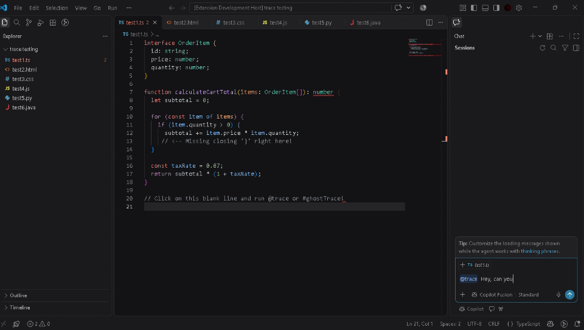

# Ghost Trace (`ghost-trace`)

Ghost Trace helps trace confusing diagnostics back to their likely upstream cause. It examines complete source files with line numbers and their diagnostics reported by VS Code, then gives guidance without editing your code.

## Preview



## Features

- **Multi-file `@trace` analysis:** Pin or attach one or more files in Copilot Chat to analyze them together, including files that are not open in an editor. If no files are attached, Ghost Trace uses the active editor.
- **`#ghostTrace` Language Model Tool:** Reference `#ghostTrace` in Copilot Agent to invoke `ghost_trace_diagnose`. Its optional `targetLine` input focuses the diagnosis on a one-based line number, and optional `filePaths` accepts workspace-relative or absolute paths for one or more files, including closed files.
- **Clickable line-jump links:** Responses can include `[Line X]` links that navigate to the corresponding file and highlight its line briefly.
- **Learning follow-ups:** `@trace` offers follow-up prompts about error cascades and prevention.
- **Language-agnostic guidance:** Diagnosis is based on each supplied file's actual language and syntax rather than a fixed language list.
- **Read-only behavior:** Ghost Trace explains the cause and how to address it; it never edits or applies changes to user code.

## Requirements

- Visual Studio Code `1.146.0` or later.
- GitHub Copilot and Copilot Chat for chat participant and Agent usage.
- Bun is required only to install dependencies and build from source.

## Use

1. Open a file with an error diagnostic, or pin/attach multiple files in Copilot Chat.
2. Ask `@trace` to investigate, or reference `#ghostTrace` in Copilot Agent. For the tool, optionally provide `filePaths` (workspace-relative or absolute) and a `targetLine`.
3. Review the per-file overview, status, root-cause location, cascade explanation, and fix guidance.
4. Click a line link to navigate to and briefly highlight that location. Ghost Trace never edits or applies changes to your code.

## Build from Source

```sh
git clone https://github.com.git/zyrndotio/ghost-trace.git
cd ghost-trace
bun install
bun run compile
```

Run `bun run watch` to rebuild the CommonJS extension bundle as source files change.

## License

This project is licensed under the [MIT License](./LICENSE).

## Changelog

See [CHANGELOG.md](./CHANGELOG.md) for release history.
